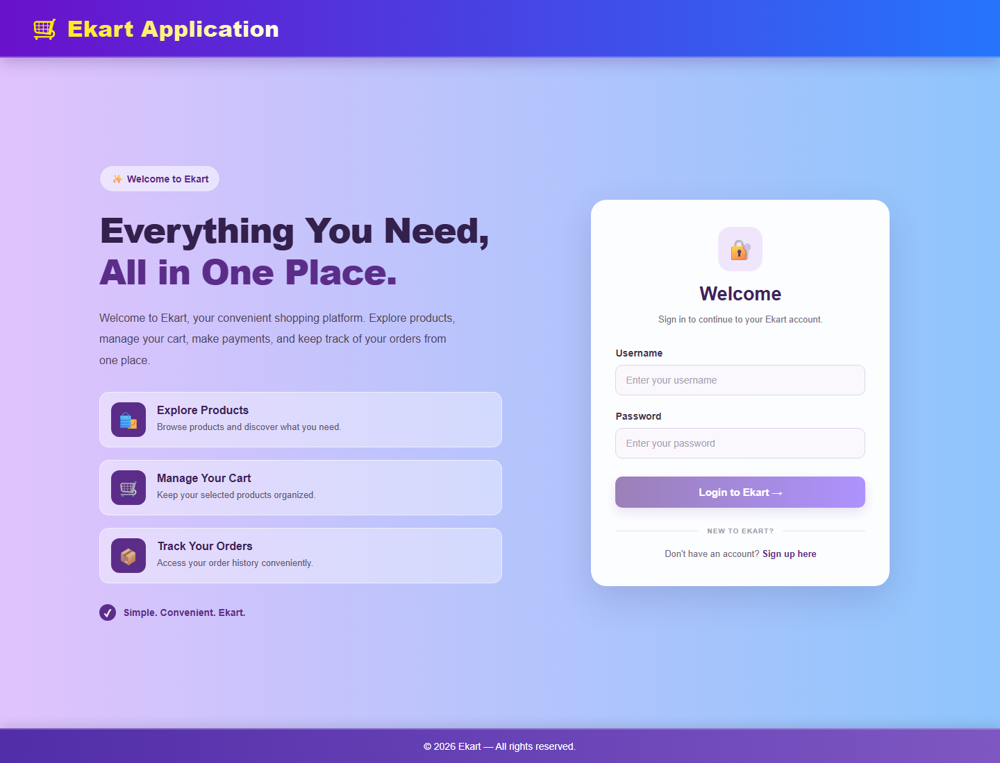
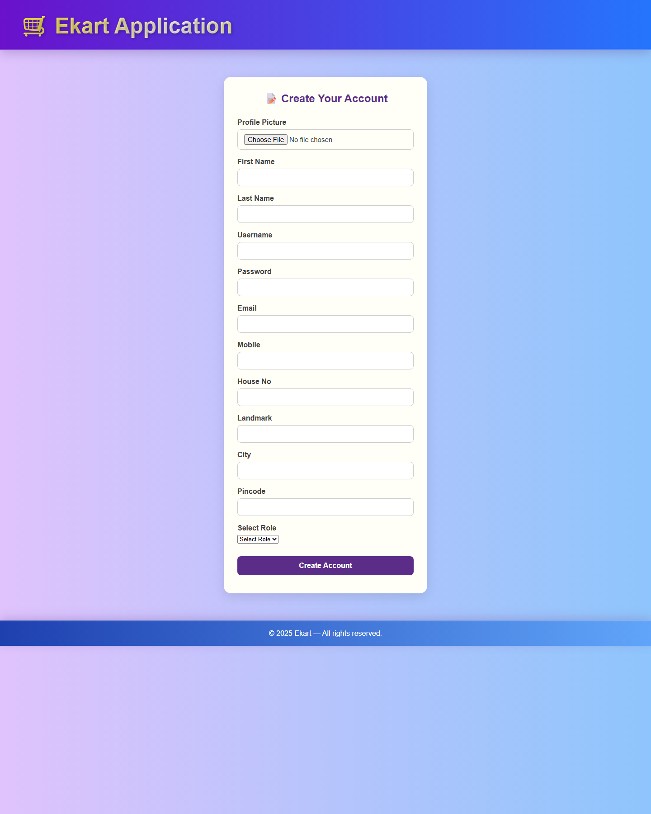
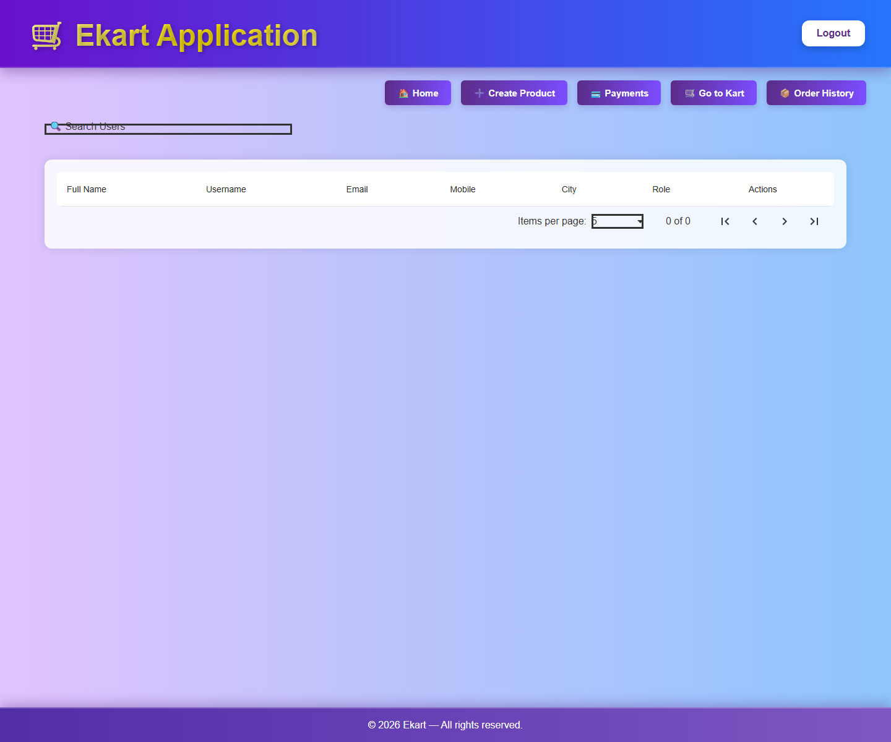
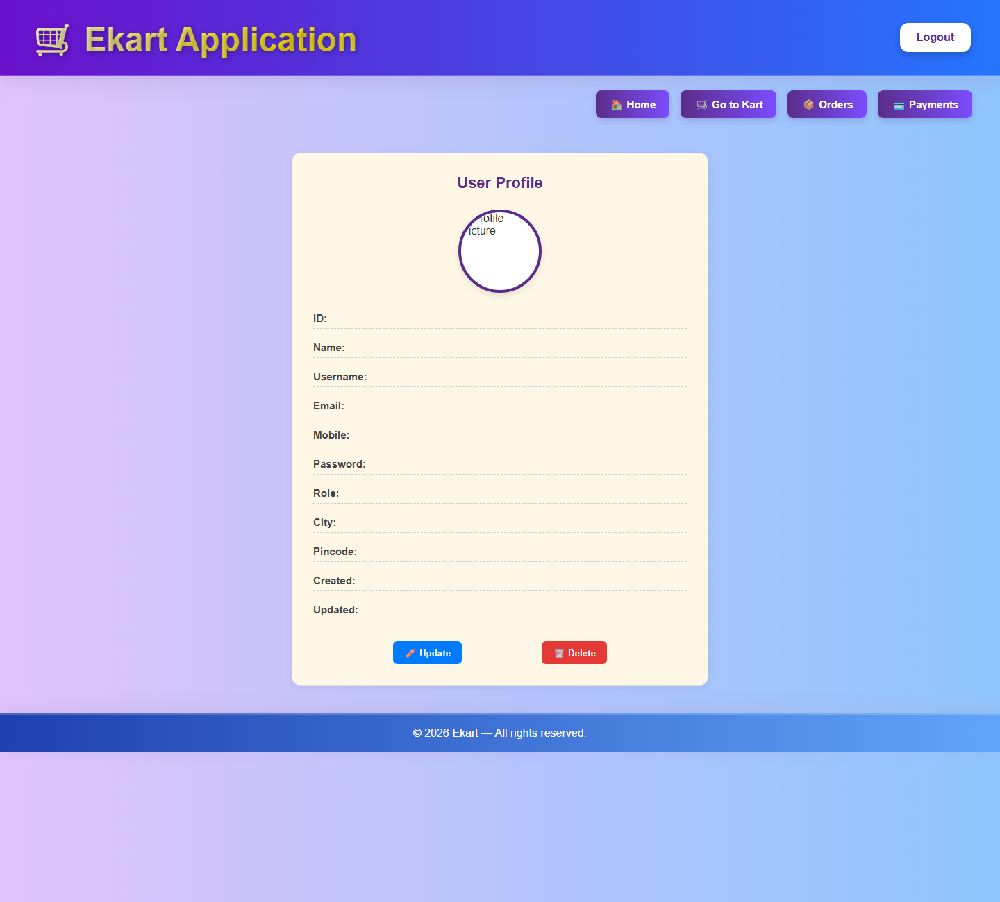
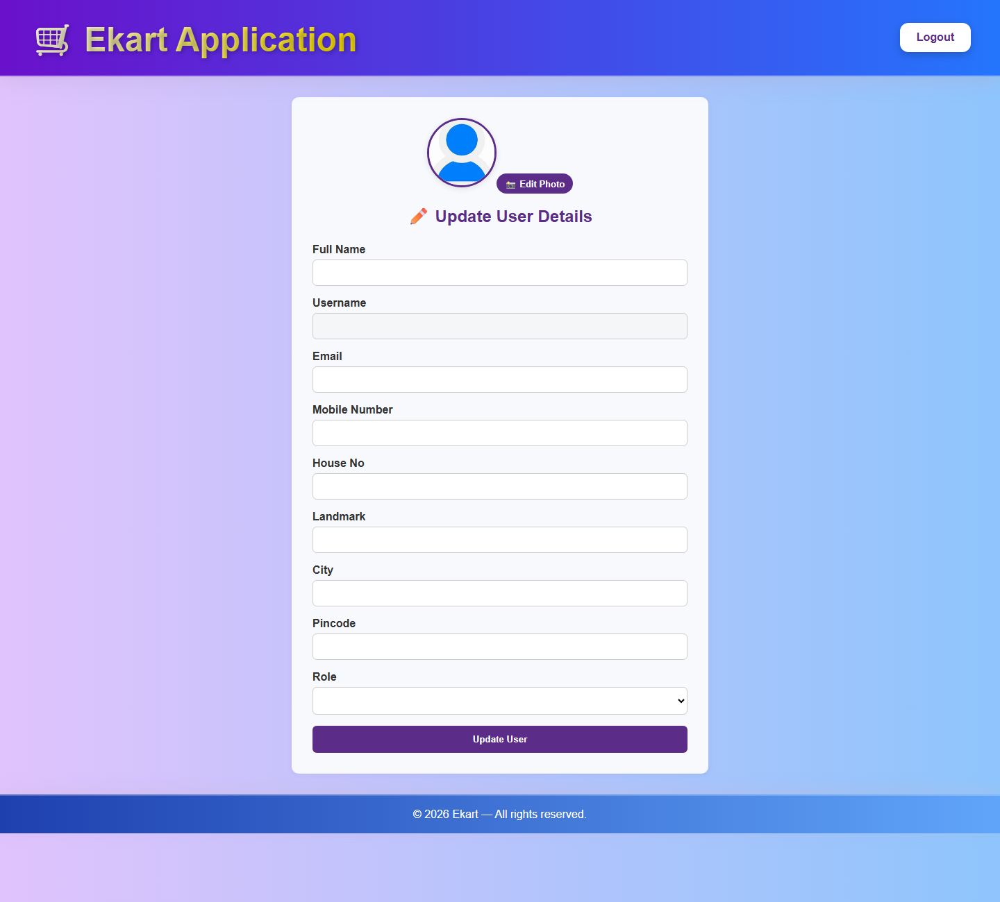
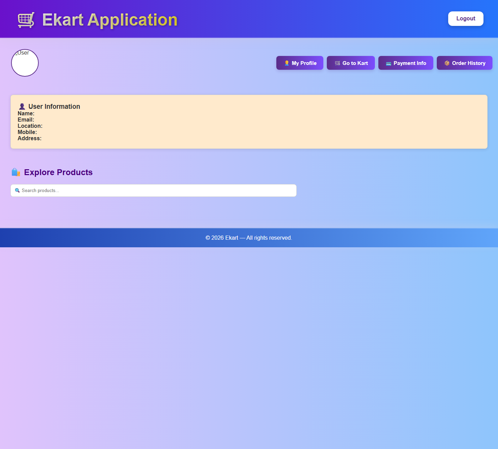
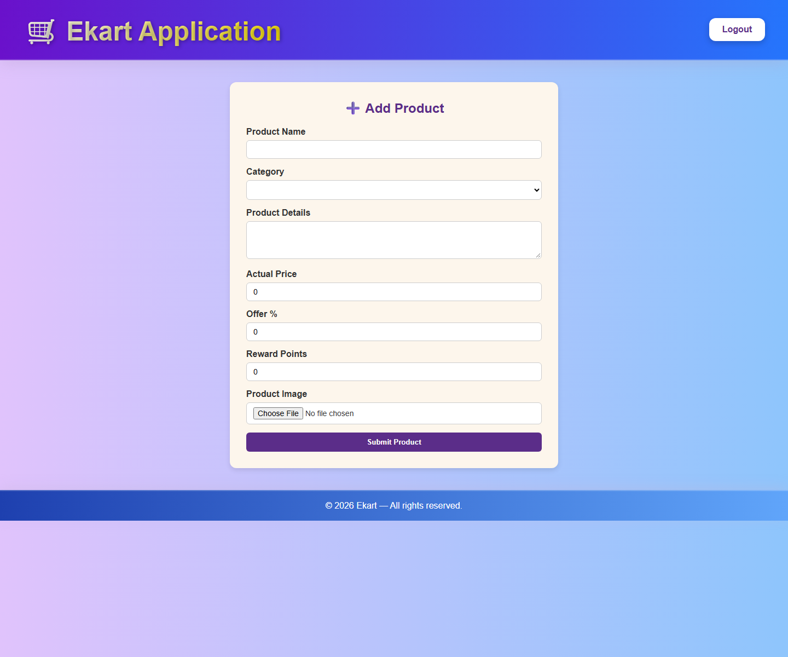
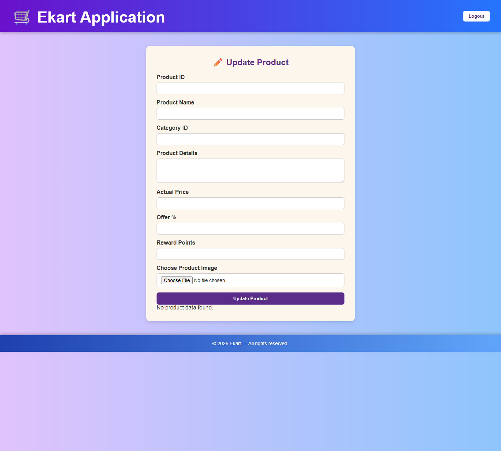

# Ekart Application

Ekart is a full-stack e-commerce project: a Spring Boot REST API backed by MySQL and an Angular 17 web application. It supports user accounts and JWT authentication, product browsing and administration, shopping carts, checkout, order/payment lookup, and wallet operations.

## Project structure

```text
.
├── src/                 # Spring Boot backend
├── frontend/            # Angular frontend
└── docs/screenshots/     # Angular UI screenshots
```

## Technology

| Part | Stack |
|---|---|
| Backend | Java 17, Spring Boot 3.1.12, Spring Web, Spring Security, Spring Data JDBC |
| Database | MySQL |
| Authentication | JWT and BCrypt password hashing |
| Frontend | Angular 17, Angular Material, TypeScript |

## Prerequisites

- JDK 17 and MySQL Server
- Node.js 20 LTS (20.9 or later) and npm
- The MySQL database and tables expected by the application

The configured default database is `billa2024` on `localhost:3306`. This repository does not include database creation scripts or migrations; create the database and required tables before starting the backend.

## Configure and run the backend

The active Spring profile is `local`. Put machine-specific values in `src/main/resources/application-local.properties`; that file is ignored by Git. For example:

```properties
spring.datasource.driver-class-name=com.mysql.cj.jdbc.Driver
spring.datasource.url=jdbc:mysql://localhost:3306/billa2024?allowPublicKeyRetrieval=true&useSSL=false
spring.datasource.username=root
spring.datasource.password=YOUR_LOCAL_MYSQL_PASSWORD
app.jwt.secret=YOUR_BASE64_ENCODED_SECRET
```

Use a stable, Base64-encoded JWT secret containing at least 32 random bytes. Generate one in PowerShell:

```powershell
$rng = [System.Security.Cryptography.RandomNumberGenerator]::Create()
$key = New-Object byte[] 32
$rng.GetBytes($key)
$rng.Dispose()
[Convert]::ToBase64String($key)
```

Do not commit or share `application-local.properties`, database passwords, or JWT secrets.

From the repository root, start the backend:

```powershell
.\mvnw.cmd spring-boot:run
```

The API listens on `http://localhost:8080` by default. IntelliJ users can also import the Maven project and run `Ekart2Application`.

## Configure and run the Angular frontend

Keep MySQL and the backend running, then open a second terminal:

```powershell
cd frontend
npm ci
npm start
```

Open `http://localhost:4200`. The frontend currently sends requests to `http://localhost:8080`; the backend CORS configuration allows the default Angular origin. Build the frontend with:

```powershell
npm run build
```

## Angular screens and functionality

| Route | Screen and functionality |
|---|---|
| `/login` | Sign in with a username and password; the app stores the returned JWT and can look up the user's role. |
| `/signup` | Create an account with profile, contact, address, and role fields. |
| `/home` | Home/dashboard screen. |
| `/userhome` | User landing page and shopping entry point. |
| `/updateuser` | Edit user profile information. |
| `/products` | Browse/search products and access product actions exposed by the app. |
| `/createproduct` | Enter product details to create a product. |
| `/updateproduct` | Edit an existing product. |
| `/kart` | View and manage cart items and proceed to checkout. |
| `/order` | View and filter order records. |
| `/payment` | View and filter payment records. |

The frontend uses an HTTP interceptor to attach the stored JWT to API requests. The root route redirects to `/login`. Wallet balance and top-up are available through the backend API; there is no separate wallet route in the current Angular route configuration.

## Screenshots

The login and signup screenshots show the initial blank forms. The authenticated-route screenshots show the actual Angular screens with empty data fields and tables; the backend/database was not connected for this capture, so they do not contain example or fabricated account, product, cart, order, or payment data.

### Sign in and account registration

| Login | Sign up |
|---|---|
|  |  |

### User and administration screens

The admin home screen provides user search, a paginated user table, and navigation to product, cart, payment, and order functions. The user home screen presents account details and links into shopping, profile, cart, orders, and payments. The profile editor exposes the contact and address fields that can be updated.

| Admin home and user list | User profile home |
|---|---|
|  |  |



### Product screens

The product screen includes product search/browsing. The create and update forms cover product name, category, description, price, offer, reward points, and image selection.

| Browse products | Create product |
|---|---|
|  |  |



Cart, order, and payment screens are also implemented in the Angular app, but their useful contents depend on an authenticated session and backend data; screenshots for those data-backed views are not included.

## REST API reference

Base URL: `http://localhost:8080`

Unless noted as public, send the JWT returned by authentication as `Authorization: Bearer <token>`. JSON endpoints accept and return JSON. Application responses generally use a `statusCode` and `data` envelope; the authentication endpoint returns a JSON object containing `token`.

### Authentication and users

| Method | Endpoint | Access | Parameters/body | Purpose |
|---|---|---|---|---|
| `GET` | `/auth/v1/mes` | Public | — | Basic API status response. |
| `POST` | `/auth/v1/authenticate` | Public | JSON: `{"username":"…","password":"…"}` | Verify credentials and return a signed JWT. |
| `POST` | `/user/v1/post` | Public | User JSON: `firstName`, `lastName`, `userName`, `password`, `emailId`, `mobileNum`, `houseNo`, `landmark`, `city`, `pincode`, `role` | Register a user; the backend BCrypt-encodes the submitted password. |
| `GET` | `/user/v1?userName=…` | JWT; user or admin role | Required `userName` | Retrieve a user by username. |
| `PUT` | `/user/v1` | JWT; user or admin role | User JSON | Update a user record. |
| `GET` | `/user/v1/all` | JWT; user or admin role | — | List user records. |
| `GET` | `/user/v1/getRole?userName=…` | JWT; user or admin role | Username query parameter | Look up a user's role. |
| `DELETE` | `/user/v1?userId=…` | JWT; user or admin role | Required `userId` | Delete a user record. |

### Products and cart

| Method | Endpoint | Access | Parameters/body | Purpose |
|---|---|---|---|---|
| `POST` | `/product/v1` | JWT; user or admin role | Product JSON: `productId`, `productName`, `categoryId`, `productImageUrl`, `productDetails`, `actualPrice`, `offerPercentage`, `usageRewardPoints` | Create a product. |
| `GET` | `/product/v1?productId=…` | JWT; user or admin role | Required `productId` | Retrieve one product. |
| `PUT` | `/product/v1` | JWT; admin role | Product JSON | Update a product. |
| `DELETE` | `/product/v1?productId=…` | JWT; admin role | Required `productId` | Delete a product. |
| `GET` | `/product/v1/all?mode=NONE` | JWT; user or admin role | Required `mode`; `categoryId` optional | List products. Use `mode=CATEGORY_ID&categoryId=…` to filter by category. |
| `GET` | `/kart/v1?userId=…` | JWT; user or admin role | Required `userId` | Get the user's cart. |
| `PUT` | `/kart/v1/addproducts` | JWT; user or admin role | `{"userId":"…","products":["product-id"]}` | Add products to a cart. |
| `DELETE` | `/kart/v1/delete?userId=…&productId=…` | JWT; user or admin role | Required `userId` and `productId` | Remove a product from a cart. |

### Orders and payments

| Method | Endpoint | Access | Parameters/body | Purpose |
|---|---|---|---|---|
| `GET` | `/order/v1/getAll?mode=…` | JWT-protected route | Required `mode`; optional `userId`, `orderDate` (`YYYY-MM-DD`), `paymentStatus`, `orderStatus` | Retrieve orders, optionally filtered. Modes: `NONE`, `ORDER_DATE`, `PAYMENT_STATUS`, `ORDER_STATUS`, `USER_ID`. |
| `GET` | `/order/v1/getOrders?mode=…` | JWT-protected route | Same query parameters as `getAll` | Retrieve order records in the list response format. |
| `GET` | `/order/v1/get?mode=…` | JWT-protected route | Required `mode`; optional `orderId`, `transactionId` | Retrieve one order. Modes: `ORDER_ID`, `TRANSACTION_ID`. |
| `PUT` | `/payment/v1/products` | JWT; user or admin role | `{"userId":"…","paymentMode":"WALLET"}` | Purchase all products in the user's cart. |
| `PUT` | `/payment/v1/buysomeproducts` | JWT; user or admin role | `{"userId":"…","paymentMode":"WALLET","products":["product-id"]}` | Purchase selected cart products. |
| `GET` | `/payment/v1/getAll?mode=…` | JWT-protected route | Required `mode`; optional `userId`, `paymentStatus`, `paymentMode` | Retrieve payments. Modes: `NONE`, `USER_ID`, `PAYMENT_STATUS`, `PAYMENT_MODE`. |
| `GET` | `/payment/v1/get?mode=…` | JWT-protected route | Required `mode`; optional `paymentId`, `orderId` | Retrieve one payment. Modes: `PAYMENT_ID`, `ORDER_ID`. |

Supported payment modes are `PHONE_PAY`, `GOOGLE_PAY`, `PAYTM`, `DEBIT_CARD`, `CREDIT_CARD`, and `WALLET`. Payment status values include `SUCCESS`, `FAILURE`, and `PENDING`.

### Wallet

| Method | Endpoint | Parameters/body | Purpose |
|---|---|---|---|
| `GET` | `/wallet/v1?userId=…` | Required `userId` | Retrieve wallet details and balance. |
| `PUT` | `/wallet/v1/addmoney` | `{"userId":"…","amount":100.0}` | Add funds to a user's wallet. |

### Example: authenticate and call a protected endpoint

```powershell
$auth = Invoke-RestMethod -Method Post `
  -Uri 'http://localhost:8080/auth/v1/authenticate' `
  -ContentType 'application/json' `
  -Body '{"username":"YOUR_USERNAME","password":"YOUR_PASSWORD"}'

$headers = @{ Authorization = "Bearer $($auth.token)" }
Invoke-RestMethod -Method Get `
  -Uri 'http://localhost:8080/product/v1/all?mode=NONE' `
  -Headers $headers
```

## Build and tests

Run the user registration/authentication/message endpoint tests with the isolated H2 test database (no local MySQL credentials are used):

```powershell
.\mvnw.cmd "-Dtest=AuthControllerMockitoTest,AuthEndpointsIntegrationTest" test
```

These tests cover user creation, password hashing and initial cart/wallet creation, successful JWT authentication, invalid-password rejection, and the public status endpoint. Mockito-based controller tests run alongside H2-backed Spring MVC integration tests. The existing full application-context test in the default suite uses the configured database, so it still needs a reachable MySQL database and the expected schema.

Build and run the backend tests with:

```powershell
.\mvnw.cmd clean install
```

The application-context test requires a reachable MySQL database with the expected schema. Build the Angular app with `npm run build` from `frontend/`.

## Notes

- Database credentials and the JWT signing secret belong only in the ignored local properties file.
- `frontend/node_modules/`, Angular's `.angular/` cache, and generated `dist/` output are excluded from Git.
- Endpoint behavior and required fields should be checked against the controllers and models as the API evolves; no database schema or migration scripts are currently included.
